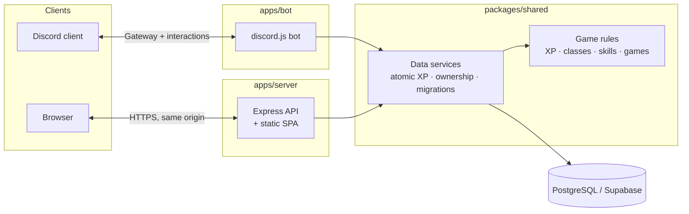

# TaskQuest

TaskQuest is a gamified task manager. You keep to-do lists, and finishing work earns XP, levels, classes, skills and achievements. There are also a few mini-games for spending or winning XP.

You can use it in two places, and both share one account and one database:

- **Discord bot**: 30 slash commands, buttons and modals inside any server (see [docs/COMMANDS.md](docs/COMMANDS.md)), plus deadline and task reminders by DM.
- **Web app**: a React dashboard with Discord sign-in, visual skill trees, statistics, a focus timer, a shop, a leaderboard, three web-only arcade games and optional push notifications.

A task completed in Discord shows up on the web immediately, and a class bought on the web applies in Discord.

> This repository merges the former `taskquest-botv2` (bot v3.8.3) and `taskquest-web_deploy` (web v1.5) repositories into a single monorepo (v4.0.0). See [CHANGELOG.md](CHANGELOG.md) for what changed.

---

## Contents

- [Features](#features)
- [Architecture](#architecture)
- [Repository layout](#repository-layout)
- [Quick start](#quick-start)
- [Scripts](#scripts)
- [Configuration](#configuration)
- [Documentation](#documentation)
- [Security](#security)

## Features

| Area | What you get |
|---|---|
| **Tasks** | Lists with description, category, priority and deadline. Tasks have their own due date, priority, tags, subtasks and a repeat rule, and can be added (also from one line of text), edited, reordered, completed in bulk, deleted with undo, searched (names and descriptions) and saved as templates. |
| **Progression** | XP for creating lists, adding tasks and completing tasks, plus capped bonuses for good habits (first task of the day, clearing a list, finishing early, clearing overdue work, subtasks, habit streaks, achievements, streak chests, focus sessions, a weekly review). Levels come from lifetime XP (100 XP a level). A daily reward with streaks and freezes. See [docs/XP_GUIDE.md](docs/XP_GUIDE.md). |
| **Quests** | Daily, weekly, a rotating weekly pool and a monthly boss, all computed from what you actually did in your own day. |
| **Classes** | Seventeen classes (Default, Hero, Gambler, Assassin, Wizard, Archer, Tank, Monk, Artisan, Ranger, Necromancer, Paladin, Bard, Alchemist, Druid, Chronomancer, Warden), each changing how XP is earned. Choosing one: [docs/CLASS_GUIDE.md](docs/CLASS_GUIDE.md). |
| **Skills** | 96 skills in 12 trees, all with real effects that work the same on both platforms. |
| **Achievements** | 33 achievements for lists, tasks, XP, levels, streaks, classes, games and spending; each pays 25 XP. |
| **Prestige and shop** | At level 30, start over for a permanent XP bonus and a title. Spend XP on titles, avatar frames and profile accents with no gameplay effect. |
| **Sharing** | Share a list with viewer, editor or manager roles (invited by Discord username), and team up in parties of up to six with a shared weekly quest. |
| **Games** | Blackjack (bet XP, with double down, flat payouts), Rock Paper Scissors and Hangman on both platforms; Snake, Dino Runner and Space Invaders on the web, verified by server replay. Every outcome is decided by the server. |
| **Automation** | Deadline and per-task reminder DMs at your own reminder hour and time zone (with Snooze), an overdue notice, an opt-in weekly summary DM, optional browser push, and optional clean-up of finished lists. |
| **Your data** | JSON and CSV export, reward-free JSON and CSV import, and a private calendar feed (`.ics`) of deadlines and due dates. |
| **Web app** | Dashboard, Stats, Focus, Review, Shop and Party pages, light and dark themes, a Ctrl+K command palette, keyboard shortcuts (including `j`/`k`/`x`/`e`/`d` on tasks), an installable home-screen app, a responsive layout with an accessible mobile drawer, reduce-motion setting, on-screen game controls. |
| **AI assistant** (optional) | Summaries of a quest, your day or your week; a "what should I do next?" ranking; and a chat that knows your quests, answers how-to questions, and can create, update, break down or complete tasks after you confirm. Gemini + LangChain + LangGraph. See [docs/AI_INTEGRATION.md](docs/AI_INTEGRATION.md). |
| **Leaderboard** | Boards for lifetime XP, XP earned this week, streaks and balance, filterable by class. Discord IDs are never exposed. |

> There are no screenshots yet ([KNOWN_ISSUES #26](docs/KNOWN_ISSUES.md)). `CAPTURE_SCREENSHOTS=1 npm run e2e -w @taskquest/web -- screenshots` takes them from the seeded test app; see [CONTRIBUTING](CONTRIBUTING.md#readme-screenshots).

## Architecture



- **`@taskquest/shared`** is the single source of truth. Every XP change, purchase and game outcome happens there, inside a database transaction that locks the user's row. The bot and the API only render results.
- **The web app is served by the API on the same origin.** Session cookies are first-party, `SameSite=Lax`, and protected against CSRF.
- **The schema is owned by versioned migrations.** These are idempotent and lock-protected, and both apps run them on startup.

More detail is in [docs/ARCHITECTURE.md](docs/ARCHITECTURE.md).

## Repository layout

```
TaskQuest-Application/
├── apps/
│   ├── bot/        Discord bot (CommonJS, discord.js 14)
│   ├── server/     Express API + Discord OAuth, serves the built web app
│   ├── web/        React 18 + Vite + Tailwind 4 + shadcn/ui single-page app (Vitest and Playwright tests)
│   └── ai/         Optional private AI service (Python, FastAPI, LangGraph)
├── packages/
│   └── shared/     @taskquest/shared: rules, validation, DB services, migrations
├── db/legacy/      Historical MySQL-era SQL scripts (do not run; see its README)
├── docs/           Product, architecture, API, gameplay, player guides, deployment docs (index: docs/README.md)
├── scripts/        Repository tooling
└── render.yaml     Render blueprint (web service, bot worker, optional AI service)
```

## Quick start

**Requirements:** Node.js 22+ and npm 10+, and a PostgreSQL 15+ database with the `vector` (pgvector) and `citext` extensions. Production uses Supabase; locally, the `pgvector/pgvector:pg16` Docker image works. You also need a Discord application from the [developer portal](https://discord.com/developers/applications).

```bash
git clone https://github.com/Mist10148/TaskQuest-Application.git
cd TaskQuest-Application
npm install
```

1. **Create a database.** With Docker, `npm run db:up` does it for you (set `DB_PASSWORD=taskquest-dev` in `.env`). Otherwise use something like `CREATE DATABASE taskquest;` (the first migration enables `citext` and `vector` if your user may; otherwise run `CREATE EXTENSION` for both as an admin).
2. **Configure.** One `.env` at the repository root is shared by the bot, the web server and the web build:
   ```bash
   cp .env.example .env
   ```
   - Fill in `DISCORD_TOKEN`, `CLIENT_ID`/`DISCORD_CLIENT_ID`, `DISCORD_CLIENT_SECRET`, `SESSION_SECRET` and the database settings.
   - In the Discord portal, add the OAuth2 redirect `http://localhost:8080/api/auth/callback`.
3. **Create the tables.** Both apps also do this on startup.
   ```bash
   npm run db:migrate
   ```
4. **Register the slash commands.** Use `-- --guild=<id>` for instant updates in a test server.
   ```bash
   npm run deploy:commands -- --guild=YOUR_TEST_GUILD_ID
   ```
5. **Run everything.** Use three terminals:
   ```bash
   npm run dev:server   # API on http://localhost:3001
   npm run dev:web      # Web app on http://localhost:8080 (proxies /api)
   npm run dev:bot      # Discord bot
   ```

Open <http://localhost:8080> and log in with Discord.

### Optional: the AI service

The AI features (summaries, "what next?" ranking, chat) run as a separate private Python service and are **off by default**. To try them locally:

```bash
cd apps/ai
python -m venv .venv && . .venv/bin/activate      # Windows: .venv\Scripts\activate
pip install -e ".[dev]"
# in the root .env: AI_ENABLED=true, AI_INTERNAL_TOKEN=<32+ random chars>, GEMINI_API_KEY=<your key>
uvicorn app.main:app --port 8000
```

Then set the same `AI_ENABLED` and `AI_INTERNAL_TOKEN` for the web server and the bot, and restart them. See [apps/ai/README.md](apps/ai/README.md) for details and [docs/AI_ARCHITECTURE.md](docs/AI_ARCHITECTURE.md) for how it works.

## Scripts

| Command | What it does |
|---|---|
| `npm run dev:web` / `dev:server` / `dev:bot` | Run each app in watch mode |
| `npm run build` | Build the web app into `apps/web/dist` |
| `npm run start:server` / `start:bot` | Production start |
| `npm run db:up` / `db:down` / `db:reset` | Start, stop, or recreate the local Docker PostgreSQL (`docker-compose.yml`) |
| `npm run db:migrate` | Apply pending database migrations (`001_baseline` and any later ones; both apps also do it on start) |
| `npm run arcade-report` | How fast real players score in the arcade games, to check the plausibility bound (needs run history) |
| `npm run deploy:commands` | Register Discord slash commands (`-- --guild=ID` for one guild) |
| `npm run lint` / `typecheck` | ESLint for the web app and the Node packages (`lint:node`, config in `eslint.config.node.mjs`), and TypeScript for the web app |
| `npm run test:e2e` | Playwright browser tests against the built app, a real API and a throwaway database (see [CONTRIBUTING.md](CONTRIBUTING.md#browser-tests)) |
| `npm run check` | `node --check` every Node source file |
| `npm test` | Unit tests (Node packages, the docs consistency test and the web app's Vitest suite). Integration tests also run when `TEST_DB_NAME` is set (see [CONTRIBUTING.md](CONTRIBUTING.md)). |

## Configuration

All apps share one git-ignored `.env` at the repository root, documented in [`.env.example`](.env.example) and [docs/DEPLOYMENT.md](docs/DEPLOYMENT.md#3-environment-variables). Settings are read in this order, and the first one found wins:

1. Real environment variables (Render, CI, your shell).
2. Optional per-app overrides in `apps/bot/.env` or `apps/server/.env`.
3. The root `.env`.

Vite only exposes `VITE_*` variables to the browser, so the secrets in that file never reach the client.

## Documentation

| Document | Contents |
|---|---|
| [docs/README.md](docs/README.md) | Index of every document, with the date it was last checked against the code |
| [docs/PRD.md](docs/PRD.md) | Product requirements: goals, personas, user stories, requirements, roadmap |
| [docs/ARCHITECTURE.md](docs/ARCHITECTURE.md) | Components, data flow, transactions, security design |
| [docs/API.md](docs/API.md) | Every REST endpoint with request and response shapes |
| [docs/COMMANDS.md](docs/COMMANDS.md) | Every Discord command and interaction |
| [docs/GAMEPLAY.md](docs/GAMEPLAY.md) | XP, levels, classes, skills, achievements and game rules, with exact numbers |
| [docs/XP_GUIDE.md](docs/XP_GUIDE.md) | How XP is earned: every source with its amount, cap and modifiers |
| [docs/CLASS_GUIDE.md](docs/CLASS_GUIDE.md) | Choosing a class: what each rewards, example builds and pitfalls |
| [docs/PLAYER_FAQ.md](docs/PLAYER_FAQ.md) | Streaks, freezes, reminders, time zone days, prestige, sharing and push, from the player's side |
| [docs/AI_ARCHITECTURE.md](docs/AI_ARCHITECTURE.md) | How the AI service works: graphs, retrieval, tools, guardrails |
| [docs/AI_INTEGRATION.md](docs/AI_INTEGRATION.md) | The AI design record: goals, decisions, and how the build differs from the plan |
| [docs/DATABASE.md](docs/DATABASE.md) | Schema, migrations, connection settings and backups |
| [docs/MIGRATION_POSTGRES.md](docs/MIGRATION_POSTGRES.md) | The move from MySQL/TiDB to PostgreSQL on Supabase: decisions, type mapping, cutover runbook |
| [docs/DEPLOYMENT.md](docs/DEPLOYMENT.md) | Render, environment variables, Discord setup, operations |
| [docs/OPERATIONS.md](docs/OPERATIONS.md) | Backups and restore, troubleshooting, and the first live Gemini run |
| [docs/design/](docs/design/) | Design records for what was built: shared lists and parties, Tailwind 4, arcade anti-cheat, and the balance rationale |
| [docs/KNOWN_ISSUES.md](docs/KNOWN_ISSUES.md) | Known limitations (the roadmap is in the PRD) |
| [SECURITY.md](SECURITY.md) | Security model, fixed vulnerabilities, required secret rotation, reporting |
| [CONTRIBUTING.md](CONTRIBUTING.md) | Development workflow, tests, conventions |
| [CHANGELOG.md](CHANGELOG.md) | Release history |

## Security

If you deployed the old repositories, rotate your Discord bot token, OAuth client secret and session secret. [SECURITY.md](SECURITY.md#1-required-action-rotate-leaked-secrets) explains why. Report vulnerabilities privately as described in [SECURITY.md](SECURITY.md#5-reporting-a-vulnerability).
