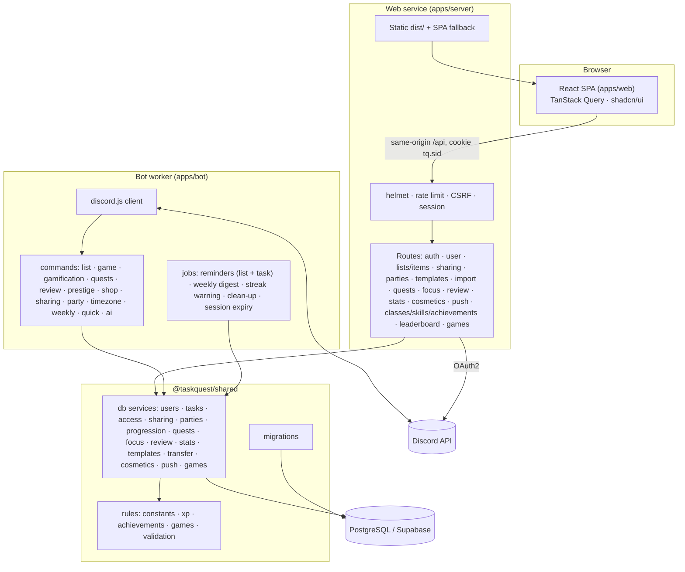
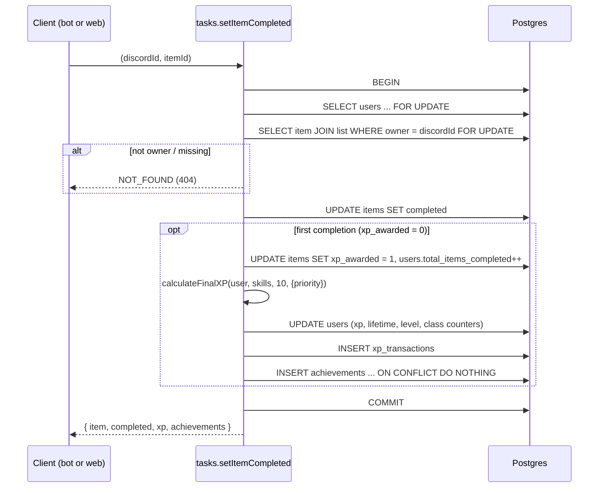

# Architecture

This document explains how TaskQuest is put together, how a request flows through it, and the design decisions that keep the two front ends consistent and the XP economy safe.

## Contents

1. [Components](#1-components)
2. [The shared package](#2-the-shared-package)
3. [Request flows](#3-request-flows)
4. [Transactions and concurrency](#4-transactions-and-concurrency)
5. [Games](#5-games)
6. [Web security design](#6-web-security-design)
7. [Bot design](#7-bot-design)
8. [Background jobs](#8-background-jobs)
9. [Configuration and startup](#9-configuration-and-startup)
10. [AI service](#10-ai-service)
11. [Testing strategy](#11-testing-strategy)

---

## 1. Components



| Component | Runtime | Responsibility |
|---|---|---|
| `apps/web` | Browser | UI only. It sends user decisions (create, toggle, bet, hit/stand, letter, arcade score) and renders server responses. |
| `apps/server` | Node 22, ESM, Express 4 | Discord OAuth2, sessions, HTTP security, request validation (zod), and mapping HTTP to shared services. Serves `apps/web/dist` in production. |
| `apps/bot` | Node 22, CommonJS, discord.js 14 | Discord commands and components, rendering embeds, background jobs and a health endpoint. |
| `packages/shared` | Node 22, CommonJS | Every rule, every SQL statement, migrations and the connection pool. |
| `apps/ai` (optional) | Python 3.12, FastAPI | Private service for the summarizer, prioritizer and chat (Gemini, LangChain, LangGraph). Reads task data through scoped queries; changes tasks only by calling Express `/internal/*` after the user confirms. See [AI_INTEGRATION.md](AI_INTEGRATION.md). |
| PostgreSQL (Supabase in production) | pgvector, citext | The only state. There is no in-memory game or session state in either app; even the Discord browsers (reorder, achievements, class browser) keep their position in the buttons' custom IDs. |

## 2. The shared package

Before 4.0, the bot and the web server each had their own copy of the classes, skills, achievements and XP formulas, plus their own SQL. The copies drifted. Achievement keys differed, completion XP was 8 on one platform and 10 on the other, the web's RPS paid back your bet as risk-free winnings, and each app ran its own conflicting `ALTER TABLE`s.

`@taskquest/shared` now owns all of that:

```
packages/shared/src
├── constants.js     CLASSES, SKILL_TREES, ACHIEVEMENTS, QUESTS, REWARDS, LIMITS, PRESTIGE, COSMETICS, PARTY_QUEST, game config
├── xp.js            levelFromXP, calculateClassXP, getSkillBonuses, calculateFinalXP, calculateDailyReward (incl. streak freezes, prestige multiplier)
├── achievements.js  evaluateAchievements(stats, unlocked, events)
├── tz.js            the user's day: zone validation, dayStart / weekStart / monthStart (DST-safe local midnights), todayInZone
├── dates.js         date-only helpers: isPastDeadline, formatDeadline, nextOccurrence, daysBetween (no zone shifts)
├── quests.js        questPeriod (the user's local day / Monday-to-Monday week / month), the rotating weekly pick
├── cosmetics.js     requirement checks for the shop (level, prestige, achievement)
├── quickAdd.js      parseQuickAdd: "Finish report fri !high #work" -> task fields
├── csv.js           CSV parsing and building (export, spreadsheet import, formula-safe cells)
├── ics.js           buildIcs: the calendar feed (RFC 5545)
├── text.js          escapeDiscord: names from other people are escaped in every DM and embed
├── games/           blackjack.js · rps.js · hangman.js · arcade.js (pure engines); snake.js · dino.js · invaders.js · rng.js (deterministic simulators the server replays)
├── push/            web push helpers (endpoint allow-list, subscription validation, payloads) and client.js, the bot's call to the web server
├── ai/client.js     client for the AI service, for non-Express callers
├── validation.js    listName, itemName, deadline, dueDate, priority, tags, recurrence, escapeLike, ...
├── random.js        CSPRNG helpers (crypto.randomInt)
├── errors.js        TaskQuestError + factories
└── db/
    ├── pool.js      pg (node-postgres) pool behind a mysql2-style layer (`?` placeholders, [rows] results, insertId via RETURNING id; UTC, DATE as string, TLS), withTransaction (retries deadlocks and serialization failures), savepoint
    ├── migrate.js   runner (advisory lock, one transaction per migration) + information_schema helpers
    ├── migrations/  001_baseline (the whole Postgres schema), 002_drop_skill_points, 003_ai_prioritize_cache, 004_item_assignee; new migrations continue from 005
    ├── users.js     profile, settings, stats, leaderboard boards, weekly digest data, reset
    ├── progression.js  applyXP, rewardAction, awardFlat, achievements, daily and streak chests, streak freezes, classes, skills, prestige
    ├── access.js    the one rule for who may touch a list or task (owner, or a member with a sufficient role); everything else calls it
    ├── sharing.js   invitations, members, roles for shared lists
    ├── parties.js   parties, invitations and the shared weekly quest
    ├── tasks.js     lists/items/subtasks (own and shared, through access.js), ordering, moving between lists, recurrence, bonuses, reminders, clean-up
    ├── assignees.js who a task is assigned to (member keys in and out, never a Discord ID), clean-up when someone leaves (internal)
    ├── quests.js    daily/weekly/monthly/rotating quest progress and atomic claims
    ├── focus.js     server-timed focus sessions
    ├── review.js    the weekly review
    ├── stats.js     XP history and summary for the Stats page
    ├── templates.js task templates
    ├── cosmetics.js the shop: buy and equip titles, frames and accents
    ├── push.js      push subscriptions
    ├── transfer.js  export, reward-free JSON and CSV import, calendar feed data and token
    └── games.js     blackjack / rps / hangman / arcade services (with replay verification), expiry
```

**Rules are pure.** The `xp`, `achievements`, `tz`, `quests` and `games` modules do no I/O and take an injectable RNG or clock, so they are unit-tested deterministically.

**Days are per user.** Database sessions stay in UTC, but every "today", week and month is a `[from, to)` pair of instants computed in JS from `users.timezone` (`tz.js`) and bound as query parameters: daily caps, quests, the weekly review, focus limits and stats all use it. The exceptions are the weekly leaderboard and the party quest, which use a single UTC week for everyone. Zone changes are limited to once every 24 hours.

**Access rule.** A list belongs to one owner (`lists.discord_id`) and may be shared through `list_members` (viewer, editor, manager; the owner is an implicit manager). Nothing decides ownership on its own: `access.forList` / `forItem` load a list or task for a user at a minimum role, and `accessSql` is the fragment for queries over many lists. A stranger gets `NOT_FOUND`, never `FORBIDDEN`, so a list's existence does not leak; a member whose role is too weak gets `FORBIDDEN`. XP, caps, quests and stats always belong to the **actor**: `rewardAction` takes the acting user's locked row, and `items.created_by` / `completed_by` / `first_completed_by` record who did what. The AI service is untouched by sharing: `routes/internal.js` calls `db.tasks.asOwner.*`, which refuses a list the user merely belongs to. An automated test enumerates every exported function of `db.tasks`, `db.templates`, `db.transfer` and `db.quests` and proves a non-member gets `NOT_FOUND` and changes nothing; a new export must be classified there. Design record: [design/shared-lists.md](design/shared-lists.md).

**Services are the only writers.** Apps never write SQL. Services validate input, enforce ownership, run in transactions, and throw `TaskQuestError(code, message, status)` for expected failures. The API maps `status` to an HTTP status. The bot shows `message` in an ephemeral embed. Any other error is treated as a bug: it is logged, and the user sees a generic message.

## 3. Request flows

### Completing a task (both platforms)



### Web login (Discord OAuth2)

1. `GET /api/auth/discord` creates a random 32-byte `state`, stores it in the session, and redirects to Discord with `scope=identify`.
2. Discord redirects back to `GET /api/auth/callback?code&state`.
3. The server compares `state` in constant time, exchanges the code (10s timeout), and fetches `/users/@me`.
4. The user row is created or updated with the cached username and avatar.
5. The session is **regenerated** (preventing session fixation) and the user is redirected to `/dashboard`.

## 4. Transactions and concurrency

Every XP change goes through `progression.applyXP(conn, user, amount, source, opts)`:

1. The caller has already locked the user row with `SELECT ... FOR UPDATE` inside `withTransaction`.
2. The new balance is computed from the locked row. A negative result throws `INSUFFICIENT_XP`.
3. `lifetime_xp` increases by `lifetimeDelta`, which defaults to the positive amount. Bet returns and refunds pass `0`. The level is derived from lifetime XP.
4. Whitelisted extra columns (class counters, ownership flags, streak fields) are updated in the same statement batch.
5. An `xp_transactions` row records the amount, the source, the before and after balances, and a reference ID.

Handing a shared list over follows the same order: it reads who the new owner is without a lock, locks their user row, then the list, and re-checks the member before counting their lists and tasks ([transfer-locks.test.js](../packages/shared/test/transfer-locks.test.js) pins the order).

Because the user row is locked for the whole operation, two concurrent requests for the same user run one after the other. A double-clicked "Buy class" charges once: the second request sees the ownership flag and fails with `CONFLICT`. A double-clicked "Stand" settles once: the second finds no active session. The integration tests check both cases.

Achievement unlocks happen in the same transaction (`ON CONFLICT DO NOTHING` on the unique key), so a reward and its achievement are never split.

## 5. Games

| Game | Where | State | Who decides the outcome |
|---|---|---|---|
| Blackjack | bot + web | `game_sessions.game_data` (deck, hands, bet) | Server (CSPRNG shuffle) |
| RPS | bot + web | single row, finished immediately | Server |
| Hangman | bot + web | `game_data` (word, guesses, lives) | Server |
| Snake / Dino / Invaders | web | session row created at start | Browser plays and records inputs; the server replays them and pays on its own score |

- **Hidden information stays on the server.** `publicView()` strips the deck, hides the dealer's hole card until the hand ends, and masks the Hangman word.
- **Escrow.** Starting Blackjack inserts the session and debits the bet in one transaction. Double down debits a second bet. Settling credits `bet + winnings` (a flat 1:1, or 3:2 for a natural; no class or skill bonuses) or returns the bet on a push. `finishSession` only updates rows with `state = 'active'`.
- **Expiry.** Active sessions older than 30 minutes are expired by a job in the bot and in the web server (every 5 minutes; whichever runs second finds nothing to do). An unfinished Blackjack hand is auto-stood and settled normally, never refunded (a refund would let players walk away from bad deals); other games just expire.
- **Free-game economy.**
  - RPS, Hangman and arcade rewards go through `rewardAction` with `maxXP` set to the remainder of the 500 XP per day cap.
  - A 3-second cooldown (`users.last_game_at`) throttles RPS and Hangman.
- **Arcade replay verification.**
  - `startArcade` issues a per-run seed. The three games are deterministic fixed-step simulators (`packages/shared/src/games/`), mirrored in `apps/web/src/lib/arcade/`.
  - The browser records its inputs and sends them with the claimed score and tick count; the server replays them and pays on the score it derives itself. The score must also be at most `elapsed_seconds × maxPointsPerSecond + 1`, with the elapsed time measured by the database clock.
  - XP per run is capped at 100–150, and a run can be submitted only once. See [design/arcade-anti-cheat.md](design/arcade-anti-cheat.md).

## 6. Web security design

| Threat | Control |
|---|---|
| CSRF (e.g. hidden form posting to `/api/user/reset`) | `SameSite=Lax` cookie on a single origin. State-changing requests must carry an `Origin` or `Referer` matching `PUBLIC_URL`/`ALLOWED_ORIGINS`. Bodies must be `application/json`. Reset also needs `{"confirm":"RESET"}`. |
| Session fixation / theft | `session.regenerate()` at login. `httpOnly`, `secure` in production, cookie name `tq.sid`, store in the database (`web_sessions`, `DbSessionStore`). |
| Login CSRF | OAuth `state` bound to the session and compared in constant time. |
| IDOR | Access is decided in one place (`access.js`: ownership or a membership row with a sufficient role) and a stranger gets 404. Discord IDs of other people are never sent to a client (members are addressed by an opaque key, tasks expose display names). |
| XSS / clickjacking | helmet CSP (`script-src 'self'`, `frame-ancestors 'none'`, `img-src 'self' cdn.discordapp.com`). React escapes output. |
| Brute force / abuse | `express-rate-limit`: 900 requests per 15 min (general), 30 per 15 min (login), 90 per minute (games). |
| Mass assignment / bad input | `.strict()` zod schemas, then service-level validation. 16 KB body limit. |
| Information leaks | Generic 500s. The health check reveals no error text. The leaderboard has no Discord IDs. |
| Weak secrets | The server refuses to start in production without a SESSION_SECRET of 32+ characters. No fallback secret. |

See [SECURITY.md](../SECURITY.md) for the full list of fixed vulnerabilities.

## 7. Bot design

- **Intents:** `Guilds` only. No privileged intents are needed: commands arrive as interactions, and DMs are sent, never read.
- **Routing:** `index.js` dispatches by interaction type, command name and `customId` prefix to the modules in `commands/` (`list`, `game`, `gamification`, `quests`, `review`, `prestige`, `shop`, `sharing`, `party`, `timezone`, `weekly`, `quick`, `ai`); [COMMANDS.md](COMMANDS.md#interaction-ids-for-developers) lists the prefixes.
- **Ownership:** `/list` replies are public, so anyone in the channel can click their buttons. A click on a message that belongs to another user is refused up front, and every handler passes the clicking user's ID to the services, so clicks on a list they have no part in only ever return "not found". On a shared list the service also checks the clicker's role (a viewer's edit click is refused).
- **Privacy:** XP, achievements, games and `/profile` are ephemeral. `/profile @user` never creates a row for the target.
- **Errors:** `utils/respond.js#handleError` turns `TaskQuestError` into a friendly embed. Anything else is logged with its stack and shown as a generic message.

## 8. Background jobs

All jobs run in the bot process. Each is wrapped so that a failure is logged and never crashes the process.

| Job | Schedule | What it does |
|---|---|---|
| Deadline and task reminders | 5s after ready, then hourly | `utils/reminders.js`: for each candidate list (`tasks.getReminderCandidates`) and task with its own due date (`getTaskReminderCandidates`) it decides, in each recipient's time zone and at their reminder hour, whether to send a *due* reminder, one *overdue* notice or a *snooze* reminder (`decideReminder`, a pure function). Shared lists remind the owner and every member with automation on, once each. At most 20 DMs a person per run; the rest collapse into one digest message. A reminder is marked handled only when the DM was sent or can never be sent (DMs closed); temporary errors retry on the next run. Reminder DMs carry Snooze and Stop buttons, and the same text is pushed to the person's subscribed browsers when web push is configured (best effort, through the web server's `/internal/push`). |
| Weekly digest | 15s after ready, then hourly | `utils/digest.js`: users who opted in (`/weekly`) get one DM on Monday at their reminder hour with their week's numbers, plus the AI recap when AI is on (best effort, never blocking). `last_digest_at` keeps it to once a week. |
| Streak warning | 20s after ready, then hourly | `utils/streakWarning.js`: one DM (and web push) on the evening of the last day a 3+ day streak can be saved; claimed through `db.today.claimStreakWarning` first so overlapping runs cannot double-send |
| Finished-list clean-up | 10s after ready, then daily | Deletes lists whose tasks have all been done for 5+ days (see [DATABASE.md](DATABASE.md#automation-queries)), never a list with members, and tells the AI service to forget their vectors. |
| Game session expiry | On ready, then every 5 min (bot and web server) | Expires sessions older than 30 minutes; an unfinished Blackjack hand is settled as a stand. |

## 9. Configuration and startup

**Server** (`apps/server/index.js`):

1. `validateConfig()` checks `PUBLIC_URL`, the Discord credentials, and `SESSION_SECRET` (≥32 characters in production).
2. It pings the database.
3. It runs migrations, or only verifies them if `MIGRATE_ON_START=false`.
4. It starts listening and handles SIGTERM/SIGINT with a graceful close.

**Bot** (`apps/bot/index.js`):

1. It requires `DISCORD_TOKEN`.
2. It pings the database and runs migrations.
3. It starts the health endpoint on `$PORT` (200 when connected to Discord, 503 otherwise) and logs in.

Migrations take a Postgres advisory lock (`pg_try_advisory_lock(hashtext('taskquest_migrations'))`, session-level, which is why Supabase is reached through its session pooler), so the bot and server can start at the same moment safely. Each migration runs in its own transaction.

## 10. AI service

The optional AI service keeps the same rules as everything else:

- **Express is the only public entry.** It authenticates the session, rate-limits, validates with zod and forwards to the AI service with a shared secret (`X-AI-Token`) and the trusted Discord ID. The browser never talks to the AI service and never chooses whose data is read.
- **One place for XP.** The AI never awards XP or edits task tables. Write tools call `POST/PATCH /internal/*` on Express, which runs the same `db.tasks.*` services as the public API, so XP, achievements and validation are identical.
- **Confirmation before any change.** A write tool pauses the LangGraph run (`interrupt`); the UI shows a card; the change runs only when the user approves. Pending confirmations are checkpointed in Postgres, so they survive reloads and restarts.
- **Scoped reads.** Every repository function takes `discord_id` (enforced by a unit test); `discord_id` is never a tool argument; extra tool arguments are rejected.
- **Degrades gracefully.** The prioritizer falls back to a deterministic ranking when Gemini is unavailable or the quota is used. The app is healthy without the AI service.
- **Schema stays in Node.** The AI tables come from migration `001_baseline`; the Python service never runs DDL.

The LangChain/LangGraph internals (RAG pipeline, graphs, checkpointer, persona, Discord conversation) are documented in [AI_ARCHITECTURE.md](AI_ARCHITECTURE.md).

## 11. Testing strategy

| Layer | Tests | Needs DB |
|---|---|---|
| Rules | `packages/shared/test/rules.test.js`: formulas, engines, validation with a deterministic RNG | No |
| Services | `packages/shared/test/db.integration.test.js`: ownership, farming, races, escrow, refunds, caps | Yes |
| HTTP | `apps/server/test/api.integration.test.js`: headers, auth, CSRF, validation, IDOR, games, privacy | Yes |
| Bot | `apps/bot/test/flows.integration.test.js`: every command flow with fake interactions | Yes |
| Docs | `packages/shared/test/docs.test.js`: the tables in `docs/GAMEPLAY.md` against `constants.js`, the class and skill description texts against `CLASS_RULES` and the skill tables, and the build tables in `docs/CLASS_GUIDE.md` against the balance simulator | No |
| Web | `tsc` + ESLint + `vite build`, Vitest unit tests for pure logic (`apps/web/src/lib/*.test.ts`, incl. theme contrast) and component tests with Testing Library in jsdom (`*.test.tsx` next to the components and pages) | No |
| Browser | `apps/web/e2e` (Playwright): the main flows against the built app, a real API and a seeded database; `npm run test:e2e` and its own CI job | Yes |
| AI client, internal token, AI schemas | `apps/server/test/ai.test.js` against a stub AI service | No |
| AI service | `apps/ai/tests`: chunking, vector store, indexer, summarizer, prioritizer paths, chat graph (routing, tools, confirmation, memory), checkpointer, red-team prompts. Offline, with fake models and temporary SQLite files; `apps/ai/tests/postgres` runs the SQL on a migrated PostgreSQL (`AI_TEST_DB_URL`, the `ai-postgres` CI job). | No (Yes for `tests/postgres`) |

Integration tests are skipped unless `TEST_DB_NAME` points at a throwaway database. CI provides a Postgres service (`pgvector/pgvector:pg16`). See [CONTRIBUTING.md](../CONTRIBUTING.md#testing).
